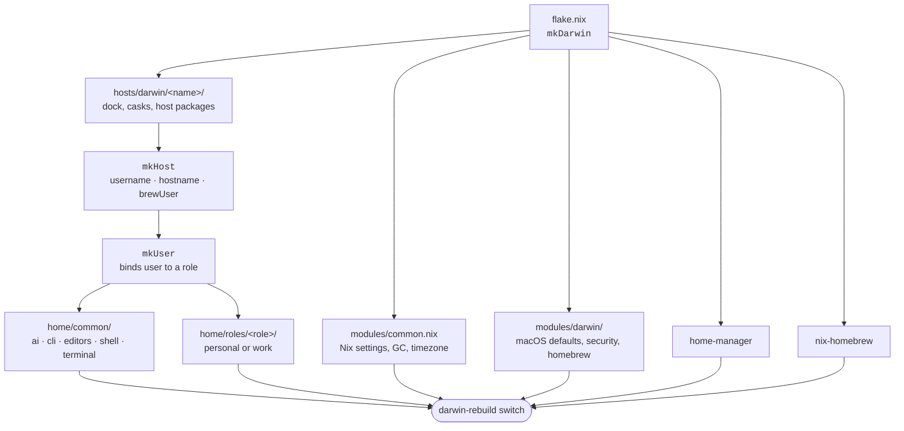

# macOS Setup

[](https://github.com/tutods/macos-setup/actions/workflows/flake-checker.yaml)
[](https://nixos.wiki/wiki/Flakes)
[](https://github.com/nix-darwin/nix-darwin)

Two Apple Silicon Macs, one personal, one work, described entirely in Nix. One command rebuilds either machine from scratch: system defaults, packages, Homebrew casks, App Store apps, shell, editors, and the whole Claude Code setup.

Built on [Nix flakes](https://nixos.wiki/wiki/Flakes), [nix-darwin](https://github.com/nix-darwin/nix-darwin), [Home Manager](https://github.com/nix-community/home-manager) and [nix-homebrew](https://github.com/zhaofengli/nix-homebrew).

```bash
./nix.sh macbook
```

## Machines

| Config | Hostname | User | Homebrew owner | Notes |
|--------|----------|------|----------------|-------|
| `macbook` | `tutods-macbook` | `tutods` | `tutods` | Personal, Doppler, Terraform, extra casks and fonts |
| `work` | `daniel.a.sousa` | `daniel.a.sousa` | `admin.daniel.a.sousa` | Corporate DNS left untouched; Atlassian `acli` tap |

Both are `aarch64-darwin`. Adding a third is a directory copy and one line in `flake.nix`, see [adding-host-or-user.md](docs/adding-host-or-user.md).

## How a machine is assembled



Innermost wins: a host overrides a module, and a role overrides common.

## What's in here

**System**: macOS defaults, Touch ID for `sudo`, firewall, dock layout per machine, automatic weekly garbage collection.

**Packages**: nixpkgs for CLI and dev tools, Homebrew for GUI apps, `mas` for App Store apps. All three are declarative; nothing needs a post-install script.

**Shell**, Fish as the default shell, with abbreviations, aliases and functions in Nix, plus an oh-my-posh prompt. Ghostty as the terminal.

**Editors**, VS Code and Zed, extensions included. Configs the app itself rewrites are seeded as copies rather than read-only store symlinks, so the app can still save.

**AI**: the distinctive part. Claude Code is configured end to end from Nix: always-on instructions, on-demand skills, plugin marketplaces, and MCP servers. See [ai-setup.md](docs/ai-setup.md).

## AI setup at a glance

Everything Claude Code reads is generated from this repo, so both machines stay identical and nothing is configured by hand in a UI.

| Layer | Source | Lands in |
|-------|--------|----------|
| Always-on rules | `home/common/ai/instructions/` | `~/.claude/rules/workflow.md` |
| Custom skills | `home/common/ai/skills/local/` | `~/.claude/skills/` (real dirs, copied) |
| External skills | plugin marketplaces, declared in Nix | installed by Claude Code on next launch |
| MCP servers | `home/common/ai/mcp.nix` | `~/.claude.json` (`mcpServers`, merged) |
| Settings, hooks, statusline | `home/common/ai/settings.nix` | `~/.claude/settings.json` (merged) |

Rules are scoped to where they are actually true: always-true rules are instructions, stack-specific ones are skills that load on demand, and repo-specific ones live in that repo's own `CLAUDE.md`.

Plugins fail silently, a typo'd name is written to `settings.json`, nothing installs, and nothing is logged. `scripts/verify-plugins.sh` resolves every declared plugin against its marketplace and runs in CI.

## First-time setup

**1. Prerequisites**

```bash
sh <(curl -L https://nixos.org/nix/install)   # Nix, multi-user
xcode-select --install                         # Command Line Tools
```

**2. Clone**

```bash
git clone https://github.com/tutods/macos-setup.git ~/.dotfiles
cd ~/.dotfiles
```

**3. Apply**

```bash
./nix.sh macbook   # personal
./nix.sh work      # work
```

Builds and applies via `darwin-rebuild switch`. Fish becomes the default shell; App Store apps and editor extensions install automatically.

> On the work laptop, run `./nix.sh work` as `admin.daniel.a.sousa`, that user owns Homebrew. Home Manager still configures `daniel.a.sousa` independently.

**4. Private git identity**

Name and email are deliberately not in this repo:

```bash
mkdir -p ~/.config/git
git config --file ~/.config/git/private user.name  "Your Name"
git config --file ~/.config/git/private user.email "your@email.com"
```

Details in [private-git-config.md](docs/private-git-config.md).

## Daily usage

```bash
./nix.sh macbook               # rebuild and apply
./nix.sh macbook --build-only  # build only, no sudo, catches errors
./nix.sh macbook --force       # force rebuild
nix fmt                        # format all Nix files
nix flake check                # validate the flake
./scripts/verify-plugins.sh    # check every Claude plugin resolves
```

Run `nix fmt` before committing, a pre-commit hook enforces it.

## Structure

```
.
├── flake.nix                   Entry point: mkDarwin, formatter, both configs
├── nix.sh                      Build/apply wrapper (zero-dependency bash)
├── lib/
│   ├── mkHost.nix              Host factory: fish, home-manager, nix-homebrew
│   ├── mkUser.nix              Binds a username to a role
│   ├── mkDock.nix              Dock layout helper
│   └── ai.nix                  Skill installer, JSON merge, MCP helpers
├── modules/                    System-level, every host
│   ├── common.nix              Nix settings, timezone, GC
│   ├── darwin/                 macOS defaults, security, networking, homebrew
│   └── packages/               cli · development · media · fonts
├── hosts/darwin/
│   ├── macbook/                default · dock · networking · packages · homebrew
│   └── work/                   default · dock · packages · homebrew
├── home/
│   ├── common/                 Every user
│   │   ├── ai/                 instructions · skills · agents · workflows · settings · plugins · mcp · maintenance · init
│   │   ├── cli/                bat · gh · git · htop
│   │   ├── editors/            vscode · zed
│   │   ├── shell/              fish · oh-my-posh
│   │   └── terminal/           ghostty
│   └── roles/
│       ├── personal/           Personal-only packages, plugins, skills
│       └── work/               Work-only: acli, PR review skills
├── scripts/                    verify-plugins · darwin/ helpers
└── docs/                       Guides and reference
```

## Adding things

| What | Where |
|------|-------|
| System CLI tool | `modules/packages/cli.nix` |
| Dev tool | `modules/packages/development.nix` |
| Media tool | `modules/packages/media.nix` |
| Font | `modules/packages/fonts.nix` |
| Homebrew cask, all machines | `modules/darwin/homebrew/casks/` |
| Homebrew cask, one machine | `hosts/darwin/<name>/homebrew/casks/` |
| App Store app | `modules/darwin/homebrew/mas.nix` or the host's own `mas.nix` |
| System package, one machine | `hosts/darwin/<name>/packages.nix` |
| User program | `home/common/` |
| Claude skill | `home/common/ai/skills/local/` + the `names` list |
| Claude plugin | `home/common/ai/plugins.nix` or a role's `ai/default.nix` |

Check a package exists in stable first: `nix search nixpkgs <name>`.

## Docs

| Guide | About |
|-------|-------|
| [architecture.md](docs/architecture.md) | Module composition and how a config is assembled |
| [nix-conventions.md](docs/nix-conventions.md) | Conventions for working in this repo |
| [ai-setup.md](docs/ai-setup.md) | Claude Code: instructions, skills, plugins, MCP |
| [dropped-skill-sources.md](docs/dropped-skill-sources.md) | Skill sources that can't ship as plugins |
| [ai-lessons.md](docs/ai-lessons.md) | Gotchas hit once and worth not repeating |
| [adding-host-or-user.md](docs/adding-host-or-user.md) | Adding a machine or a user |
| [secrets.md](docs/secrets.md) | Where secrets live, never in this repo |
| [private-git-config.md](docs/private-git-config.md) | Machine-local git identity |
| [work-setup.md](docs/work-setup.md) | Work environment, Jira, corporate specifics |
| [recovery.md](docs/recovery.md) | Rebuilding from nothing |
| [fix-fish-killed.md](docs/fix-fish-killed.md) | Fish killed after an update |
| [obs-screen-sharing.md](docs/obs-screen-sharing.md) | OBS screen-sharing permissions |

## Maintenance

Garbage collection runs weekly, keeping the last 7 days of generations.

```bash
nix-collect-garbage -d              # manual clean-up
brew doctor                         # if Homebrew misbehaves after a rebuild
find ~ -name "*.backup" -mtime +7   # stale Home Manager backups
```

CI validates the flake and builds both Darwin configurations on every push and pull request, plus daily. [Renovate](.github/renovate.json) auto-merges minor and patch updates for `nixpkgs`, `home-manager`, `nix-darwin` and `nix-homebrew`; majors need review.

## License

[MIT](LICENSE)
